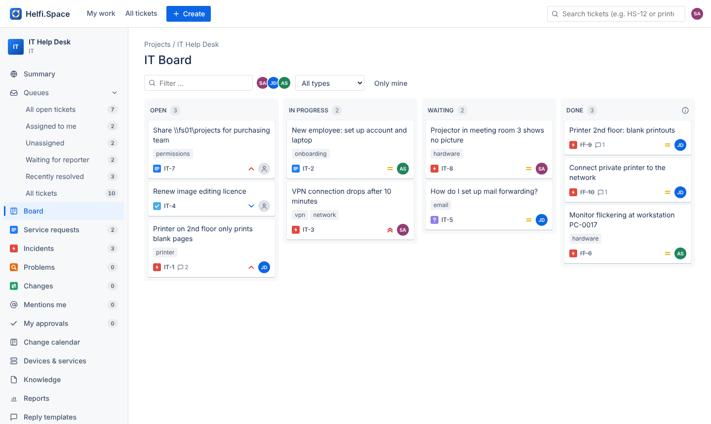
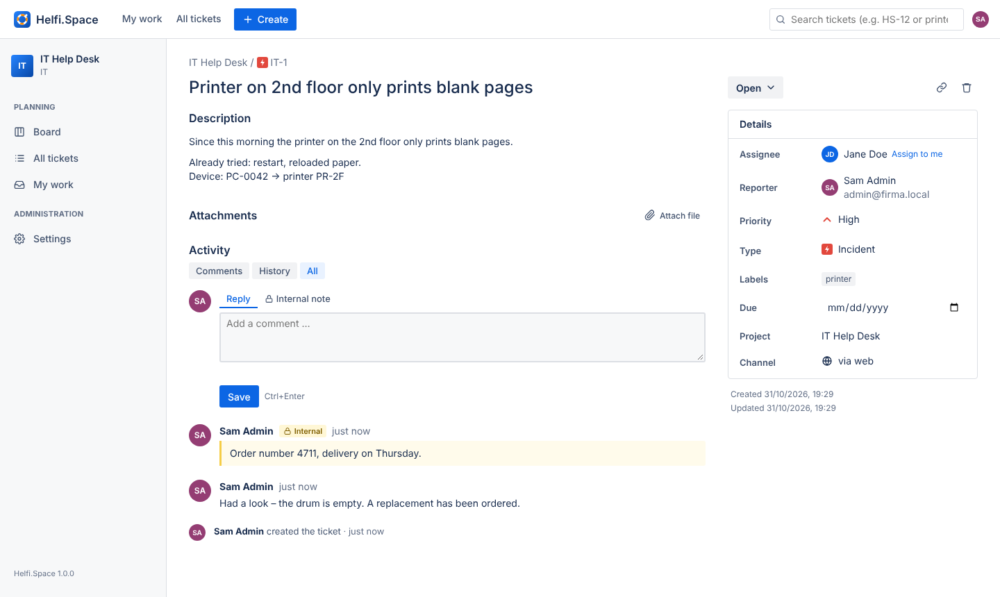
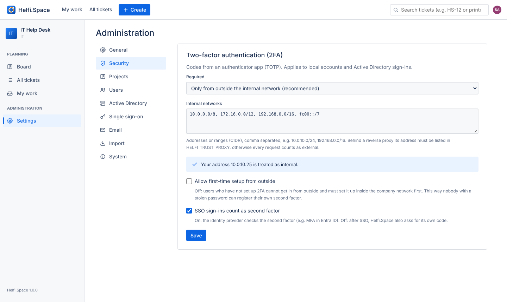

<p align="center"></p>

# Helfi.Space

[Deutsch](README.md) · **English**

A lightweight ticket system for IT departments and institutes, in German and English. Helfi.Space runs as a single Docker container with SQLite.



- **Active Directory** (Windows Server or Samba AD): sign in with Windows accounts, roles from AD groups (nested groups too), **fetch the LDAPS certificate with one click**
- **Single sign-on** via OpenID Connect: Microsoft Entra ID, ADFS, Keycloak, Authentik …
- **Email → ticket:** a mailbox is polled via IMAP, new mails become tickets and replies land in the matching ticket. Reporters get answers by email.
- **Clear and simple:** sidebar with queues (open, assigned to me, unassigned, waiting, recently resolved, all) with live counts, per-project summary, board with drag & drop, ticket list with filters, ticket view with details, comments, internal notes, attachments and history
- **Import from another ticket system** (via its REST API, cloud and Server/Data Center): projects, tickets, comments and attachments. Ticket numbers are kept.
- **Paste screenshots:** images from the clipboard with Ctrl+V right into a comment, the description or "Create ticket". In internal notes they stay internal.
- **Roles:** administrator, agent, user. Users only see their own requests.
- **Two-factor sign-in (TOTP):** on the internal network a password is enough, from outside a code from an authenticator app is required – configurable per role.
- **Local emergency admin:** created during first setup, works even when the AD is unreachable.
- Automatic backups daily and before every update



**Manual (PDF):** [English](docs/Manual.en.pdf) · [Deutsch](docs/Handbuch.pdf) – for users, agents and administrators.

---

## Installation

Requirement: Docker with Compose (Linux server, Synology, …).

```sh
mkdir helfi && cd helfi
# download docker-compose.yml, env.example and update.sh from the latest release
cp env.example .env
nano .env            # at least set HELFI_BASE_URL
docker compose up -d
docker compose logs helfi   # shows the setup code
```

Then open `HELFI_BASE_URL` in the browser. The setup wizard asks for the **setup code** from the log and creates the **local administrator** and the first project. After that it takes you straight to the AD setup.

> **Repository still private?** Then the server needs a one-time login to ghcr.io:
> `docker login ghcr.io -u <GitHub name>` with a personal access token (scope `read:packages`).

The host only holds a few things:

| | |
|---|---|
| `docker-compose.yml` | usually stays the same across updates |
| `update.sh` | manual update (optional, not needed with a container manager) |
| `.env` | your settings (address, port, version, PUID/PGID) |
| `data/` | database, attachments, backups, key file |

**Synology:** set `PUID`/`PGID` in `.env` to your user (e.g. `1026`/`100`, see `id` via SSH) so the files in `data/` belong to you.

### HTTPS (recommended)

Helfi.Space itself speaks HTTP on port 8080. In production, put a reverse proxy with HTTPS in front of it (Synology reverse proxy, Nginx Proxy Manager, Caddy, Traefik …). Then set `HELFI_BASE_URL=https://helfi.firma.local`. Cookies are then marked `Secure` automatically.

So that the brake against password guessing sees the real client address, enter the proxy's address in `.env`, e.g. `HELFI_TRUST_PROXY=10.0.10.5`. Without it, Helfi.Space trusts no `X-Forwarded-For` header, because it could otherwise be forged.

Example Caddy:

```
helfi.firma.local {
    reverse_proxy 10.0.10.20:8080
}
```

---

## Appearance (corporate design)

*Administration → General → Appearance*:

- **Logo** as PNG or SVG (512 KB at most). It replaces the logo in the header, on the sign-in page and in the browser tab. SVGs with scripts or references to external content are rejected. The logo is stored in the data folder under `brand/` and is included in backups.
- **Title next to the logo** can be hidden if the logo already contains the name.
- **Main colour** for buttons, links and highlights. The page shows the contrast to white and warns below 4.5:1, because text on buttons is then hard to read.
- **Header** light or in the main colour. With very light colours the text there automatically turns dark.
- A preview shows the effect before saving; *Reset to default* restores everything.

## Customizing the sign-in page

*Administration → General → Sign-in page*: your own heading (e.g. "Help center"), welcome text in German and optionally English, e.g. how to get help, and your own label for the user name field ("Windows user name"). Text only: `**bold**`, links and email addresses become clickable, HTML is never executed. A preview shows the result right away.

## Setting up Active Directory

*Administration → Active Directory*

1. Enter the **domain controller** using the name in its certificate (e.g. `dc01.firma.local`). Encryption: **LDAPS (636)** or **StartTLS (389)**.
2. **Fetch certificate** retrieves the certificate directly from the DC and shows the SHA-256 fingerprint. Compare it with the one on the server, then click **Accept certificate**.
   - Windows: `certlm.msc` → Personal → Certificates → the DC's certificate → Details → Thumbprint (SHA-256 via PowerShell: `Get-ChildItem Cert:\LocalMachine\My | Format-List Subject, @{n='SHA256';e={$_.GetCertHashString('SHA256')}}`)
   - Samba: `openssl x509 -in /var/lib/samba/private/tls/cert.pem -noout -fingerprint -sha256`
3. Enter a **service account**, e.g. `svc-helfi@firma.local` (a normal domain account, no special rights needed). Without a service account, Helfi.Space searches with the account that is signing in.
4. Enter the **groups** for administrators and agents, e.g. `Helfi-Admins` and `Helfi-Agents` (name or full DN). Nested groups are taken into account. Optionally, an "allowed users" group restricts who may sign in at all (admins and agents always may). If a group name is ambiguous (same name in several OUs), no role is assigned and the log says so – enter the full DN in that case.
5. **Test connection**, ideally with a test sign-in. If the base DN is empty, it is taken from the AD. If there is a Microsoft certification authority (AD CS), the test finds it and offers to accept it too. Renewed DC certificates then stay valid automatically.
6. **Enable AD sign-in** and save.

Users sign in with `m.muster`, `FIRMA\m.muster` or `m.muster@firma.local`. Users are created on their first sign-in. Their role follows from their groups at every sign-in, unless an admin has locked it under *Users* with "fixed role". If an admin changes a role by hand, it is locked automatically.

**Good to know**

- A Windows DC only offers LDAPS if it has a certificate (AD CS or installed manually). Samba AD creates one itself during provisioning.
- Every day Helfi.Space checks whether the stored certificate still matches and whether it expires soon. Problems appear as a notice for admins. After a renewal on the DC, simply **fetch the certificate** again.
- Local accounts take precedence: if a local account has the same name as an AD account, the local one wins.
- If the AD is unreachable, local accounts (the emergency admin) can still sign in.

## Two-factor sign-in (2FA)

*Administration → Security*

Default: **on the internal network a password is enough, from outside a second factor is required.** That is a 6-digit code from an authenticator app such as Microsoft Authenticator, Google Authenticator, Aegis or 2FAS. The requirement can be set separately per role:

| Setting | Options |
|---|---|
| Required when signing in from outside | all users (default) · agents and administrators · administrators only · nobody |
| Inside the internal network | no two-factor prompt (default) · administrators only · agents and administrators · all users |

Example: reporters without a code, agents with a code from outside, administrators always with a code. Installations that had "always" or "never" set keep that behaviour.

- **Requests from the server itself** (127.0.0.1) do not count as internal automatically. A reverse proxy on the same host must set X-Forwarded-For, otherwise every request would look like it came from the server itself. For testing, `127.0.0.1` can be added to the list.
- **Internal networks** are listed in the settings, one entry per line (default: `10.0.0.0/8`, `172.16.0.0/12`, `192.168.0.0/16`, `fc00::/7`). The default covers all private ranges, including Docker networks and a guest Wi-Fi. Best narrow it down to the real company networks, e.g. `10.0.10.0/24`. The page shows how your current address is classified.
- **Own internet connection:** when a computer inside the company opens Helfi.Space via its public address, it often arrives with the public IP of your own connection (hairpin NAT). Enter that IP or a DynDNS name (e.g. `203.0.113.10` or `helfi.dyndns.example`) and such requests count as internal. Names are resolved again every 5 minutes; if DNS is briefly unreachable, the last known address keeps counting. Caution: if a guest Wi-Fi uses the same connection, guests count as internal too.
- **Behind a reverse proxy** its address must be in `HELFI_TRUST_PROXY`. Otherwise Helfi.Space only sees the proxy and, to be safe, treats every request as external. Admins then get a notice.
- **Setup:** everyone sets up 2FA under *Profile → Two-factor sign-in*: scan the QR code, enter a code, save 10 recovery codes. For security, first-time setup only works on the internal network, in every mode. Once 2FA is set up, it can only be turned off with a valid code and then set up again (e.g. new phone). This way nobody with a stolen password can register their own second factor from outside. For people who only work remotely, *Security* can allow "first-time setup from outside too".
- **Sessions:** if you signed in at the office without a code and later use the same browser from home, you have to sign in again with a code there.
- **Lost phone:** sign in with a recovery code. Alternatively, an admin resets 2FA under *Users → Reset 2FA*, and the person sets it up again at the office.
- **Applies to** local accounts and Active Directory sign-ins. With **SSO**, the identity provider checks the second factor by default (e.g. MFA in Entra ID). This can be turned off, and Helfi.Space then asks for its own code as well.
- Docker note: with some Docker setups all requests seem to come from the Docker gateway, e.g. with rootless Docker or IPv6. That address therefore only counts as internal if it is listed on its own.



## Single sign-on (OpenID Connect)

*Administration → Single sign-on*

1. Create an app or client at your provider and enter the displayed address as redirect URI: `https://helfi.firma.local/auth/oidc/callback`.
2. Enter issuer URL, client ID and client secret, then **Test**.
   - **Microsoft Entra ID:** `https://login.microsoftonline.com/<tenant ID>/v2.0`. Add the groups claim under *Token configuration*. The token then contains group IDs, and you enter those IDs as admin/agent group.
   - **ADFS (Windows Server):** `https://adfs.firma.local/adfs`, application group "Server application accessing a web API". Issue the `groups` claim via a claim rule.
   - **Keycloak:** `https://keycloak.firma.local/realms/<realm>`, mapper "Group Membership" with claim `groups`.
3. Optionally enable "redirect straight to SSO". The normal sign-in page stays reachable at `/login?local=1`, e.g. for the emergency admin.

**SSO and AD together:** if you enter your domain under "Merge with AD accounts for domain" (e.g. `firma.local`), `m.muster@firma.local` from SSO is the same account as the AD user `m.muster`. Only enter the domain if the provider really controls it, i.e. does not allow guest accounts from other organizations. Without it, SSO accounts stay separate, and a guest `m.muster@fremd.example` can never take over the account `m.muster`. Email addresses from SSO are only taken over if the provider reports them as verified or they belong to the allowed domain.

## Email

*Administration → Email*

- **Polling a mailbox (IMAP):** enter server, user and password of the help desk mailbox. New mails become tickets (including attachments up to 20 MB each and up to 30 attachments; anything not taken over is noted in the ticket; mails over 80 MB are skipped and flagged in the mailbox). Replies to mails from Helfi.Space and replies from participants with `[IT-123]` in the subject become comments, quoted history is cut off. If the reporter replies to a waiting or resolved ticket, it is reopened. Out-of-office notes and automatic mails are ignored. Processed mails are marked as read or moved to a folder.
- **Sending (SMTP):** ideally use the same address as the mailbox as sender, so replies land back in the ticket.
- **Internal notes** never go out by email.
- Only participants (reporter, assignee, previous writers) may reply by ticket number in the subject. Anyone who merely guesses the number gets a new ticket of their own. Replies to mails from Helfi.Space are always matched correctly via the Message-ID.
- Sender addresses can be forged. That is why a mail never counts as an agent reply, even if it comes from an agent's address: it appears with the sender address, not under the account, and is not forwarded to the reporter. Agents reply through the web interface.
- Preferably do not read the mailbox in parallel in Outlook or on a phone: Helfi.Space only fetches unread mails. A folder for processed mails is recommended.
- Confirmations of receipt go out at most 60 times per hour (protection against abuse with forged senders).
- Loop protection: more than 20 new tickets per hour from the same sender are ignored.
- **Mail loop protection** (e.g. with monitoring systems, printers, backup software):
  - Delivery failure reports (Exchange, Postfix, …) and read receipts never become tickets or comments and are never answered.
  - If a report belongs to a mail from Helfi.Space, the ticket gets an internal note "delivery failed".
  - The affected address gets no mail for 7 days. The list is under *Administration → Email → Blocked recipients*, where an address can also be released early.
  - **Sender rules** (address or pattern like `*@zabbix.firma.local`): "Create ticket, never reply", optionally into a separate project, or "Ignore". Automatically generated emails (header `Auto-Submitted`, `Precedence: bulk`, sender `noreply@…`), as sent by Proxmox, NAS systems or monitoring, are only accepted with the rule "Create ticket, never reply". Without a rule they are skipped. *Administration → Email* lists the recently skipped emails with sender and reason.
- Senders without an account are kept as *email contacts*. If they later sign in via AD or SSO with the same address, their tickets are taken over.
- **Look up senders in AD** (default: on, requires AD sign-in with a service account): Helfi.Space searches unknown senders in AD. It checks `mail`, `userPrincipalName` and the alias addresses in `proxyAddresses`, and skips disabled accounts. With exactly one match, the person is created as an AD user right away, with the role from their groups, as if they had signed in. An existing email contact is taken over. Not found, ambiguous or AD unreachable: they become an email contact as before. Unknown addresses are not looked up again for one hour. A mail still never grants agent rights.
- **Retention:** "Delete processed mail after … days" (default 0 = never, otherwise at least 7). Once a day, older mails in the processed-mail folder are permanently deleted, at most 500 per run. Nothing is ever deleted in the inbox. If no separate folder is set, Helfi.Space deletes nothing. The content stays in the tickets.

### HTML emails

Helfi.Space shows HTML emails **formatted** in descriptions and replies, with tables, bold text, colours, signature and embedded images. A **"Formatted | Text"** switch changes to the text version; the browser remembers the choice. Editing always uses the text version. After a description has been edited, only the text applies.

- **Security:** the HTML is cleaned when the mail arrives. Scripts, forms, embedded pages, event attributes and `javascript:` links are removed. It is also shown in an isolated frame with its own security policy in which no script can run.
- **Images:** embedded images such as logos, signatures or pasted screenshots are shown. Small logos do not appear in the attachment list. **Images from the internet** (often tracking pixels) are never loaded; a notice states how many there were.
- **Replies:** the quoted history (Outlook, Gmail, Apple Mail, Thunderbird) is collapsed: "Show quoted text".
- Applies to mails received after the update.

## Request participants

Besides the reporter, other people can be involved in a ticket, e.g. colleagues with the same problem or a manager.

- **Add:** in the ticket view under *Request participants → Add*.
  - Agents search by name or enter any email address.
  - Reporters and participants can add colleagues who have an account, but no arbitrary addresses.
  - At most 20 per ticket.
- **By email:** anyone in *To* or *CC* of a new mail or a reply automatically becomes a participant. This applies to at most 10 addresses per mail; the helpdesk address and agents are not counted. Can be turned off under *Administration → Email*.
- **What participants can do:**
  - see the ticket, also under *My requests* with the filter "I am a participant"
  - comment and attach files on the web or by replying to a mail
- **What participants cannot do:** see internal notes, change status, assignee or title.
- **Notifications:** participants get the same mails as the reporter (replies, resolved), each one separately in their language, without the other addresses. People added on the web get a short mail.
- **Remove:** agents, the reporter or the person themselves.

## Editing several tickets at once

In *All tickets* (agents):
- **Select:** checkbox in front of each row, "all" in the header, Shift+click for a range, `x` for the ticket highlighted with `j`/`k`.
- **Action bar:**
  - **Resolve:** optionally with a reply to reporters and participants, with templates and per-ticket placeholders. With a reply there is no extra "resolved" mail.
  - **Status**, **Assign**, **Priority**
  - **Move to another project**
- Every change goes into the ticket history. If one ticket fails, the others still go through and the message names it.

**Tickets are never deleted**, not even by admins, so that their history remains traceable. Finished work is set to “Done”. Against spam, use a sender rule “Ignore”. A project can only be deleted if its tickets are moved to another project; to keep it together with its tickets, archive it instead.

## Links and subtasks

In the ticket view (agents) under *Links*:

- **Link:** “relates to”, “duplicates”, “blocks” / “is blocked by”, “causes” / “is caused by”, “is subtask of” / “has subtask”. The other ticket shows the link automatically, both get a history entry. With “duplicates” the ticket can be set to “Done” right away.
- **Subtasks:** create them directly (a task in the same project) or put existing tickets underneath. A progress bar shows “x of y done”. A ticket has at most one parent, circles are rejected.
- Links are only visible to agents; at most 50 per ticket.

## Emojis

In comments, descriptions and reply templates:

- **🙂 button** at the bottom right of the text field: picker with search (English and German, e.g. "thumbs" or "printer"), groups and "Recently used".
- **While typing:** `:thu` suggests 👍 (arrow keys, Enter or Tab to accept, Esc to close). A complete short name such as `:tada:` turns into 🎉 right away. Times like `12:30` and addresses are left alone.
- **Classic smileys** are converted while typing as soon as a space follows (or when sending): `:)` → 🙂, `;)` → 😉, `:D` → 😄, `:(` → 🙁, `:P` → 😛, `:O` → 😮, `<3` → ❤️, `(y)` → 👍. Only when they stand alone, so `C:)` stays as it is. **Ctrl+Z** undoes the conversion right away.
- Emojis are shown with the operating system's emoji font; nothing is loaded from the internet. They arrive in emails as usual.

## Reply templates

For replies that are always the same (e.g. "Please restart your computer"):

- **Insert:** click **Template** in the comment box, type to search, press Enter or click to insert. The text goes to the cursor position and can still be edited before saving. Works for replies and internal notes. Only agents see templates.
- **Placeholders:** `{reporter}`, `{ticket}`, `{title}`, `{agent}` (German `{melder}`, `{titel}`, `{bearbeiter}`) are replaced when inserting.
- **Create:**
  - Write a text in the comment box and choose **Save as template**.
  - Admins manage templates for everyone under *Administration → Reply templates*.
  - Every agent manages personal templates in their *profile*; only they can see them.

## Reports

*Reports* (visible to all agents) shows who worked on and resolved how many tickets:

- **Period:** last 7, 30 or 90 days, this year or a custom range; optionally one project.
- **Key figures:** created, resolved, currently open.
- **Charts:**
  - "Resolved per agent"
  - "Created and resolved" per day, per week from 93 days; hover to see the values
- **Table per agent**, sortable by every column and downloadable as CSV:
  - **Resolved:** set to "Resolved" by that person (according to history)
  - **Open assigned:** current state
  - **Worked on:** tickets with an own change or comment
  - **Replies and internal notes**
  - **Avg. resolution time:** from "created" to "resolved"

## Keyboard shortcuts

`?` shows all shortcuts in the UI. They never fire while typing in a field.

| Where | Key | Action |
|---|---|---|
| everywhere | `c` | create ticket |
| | `/` | search |
| | `g` then `b` / `i` / `m` | board / all tickets / my work |
| ticket | `i` | assign to me |
| | `a` | choose assignee |
| | `m` | comment |
| | `e` | edit title |
| | `l` | edit labels |
| | `.` | actions with search (status, priority, type, template …) |
| | `Ctrl` + `Enter` | save comment |
| lists | `j` / `k` | next / previous ticket |
| | `o` / `Enter` | open selected ticket |
| | `x` | select the highlighted ticket (multi-select) |

## Import from another ticket system

*Administration → Import*

Helfi.Space takes over projects and tickets via the REST API of the previous system: **cloud** (REST API v3) and **Server/Data Center** (REST API v2), service desk projects included. Credentials are not stored; they are only used for the running import.

1. **Connect:**
   - Cloud: address, email and API token.
   - Server/Data Center: address and personal access token, alternatively user name and password.
   - With an internal certificate, enter your own certification authority (PEM).
2. **Select projects** and choose which Helfi.Space project they go into. If the project does not exist, it is created.
3. **Map:** distribute the source system's statuses and issue types over the four statuses and types of Helfi.Space. Suggestions are prefilled, e.g. "Waiting for customer" → Waiting and "Bug" → Incident.
4. **Import:** progress is shown. The import can be cancelled.

What is taken over:

- Summary, description (as text), type, status, priority, labels, due date, created and resolved date
- Comments. Internal comments from service desk projects and comments with restricted visibility become internal notes.
- Attachments up to the chosen size

How numbers and people are handled:

- **Numbers:** `SUP-123` stays `SUP-123`. If the number is already taken in the target project, the ticket gets the next free one. New tickets continue after the highest number.
- **People** are matched by email address. Reporters without an account become email contacts, and if the person later signs in via AD or SSO, the tickets belong to them. Assignees are only assigned if they are already agents in Helfi.Space, otherwise their name appears in the history. Cloud systems may withhold email addresses depending on privacy settings; then only the name is taken over.

Also:

- **No emails** are sent.
- **Repeatable:** a second run updates tickets that have changed in the source system since (the state from there wins). Unchanged ones stay as they were edited in Helfi.Space. New comments and attachments are added, nothing is duplicated. So you can do a trial import before the switch and import once more on the cut-over day.

---

## Updates

### With a container manager (recommended)

**Dockhand**, **Watchtower** or **Tugtainer** detect new images of `ghcr.io/soleil0815/helfi.space.ticket:latest` and update the container. Recommendation: schedule updates **at night**. Helfi.Space backs up the database itself when a new version starts (`data/backups/helfi-vor-<version>-….sqlite`) and migrates it afterwards.

### Manually

```sh
./update.sh            # latest version
./update.sh 1.2.0      # specific version (recorded in .env)
./update.sh -y         # no prompts
./update.sh --cleanup  # list leftovers from earlier updates and delete them after confirmation
```

`update.sh` remembers the running version and pulls the new one. If the bundled `docker-compose.yml` is newer, it replaces the old one and keeps it as `docker-compose.yml.alt-<date>-<time>`. Then it starts the container and waits for the health check. If the new version does not start, it asks and restarts the previous version with the matching database backup (automatically with `-y`). It does not unpack or build anything. It runs with `/bin/sh`, on a Synology too.

### Cleaning up

Over time, older backup copies of `docker-compose.yml` and loaded image files from the release pile up in the folder. `./update.sh --cleanup` lists these files and only deletes them after confirmation (no prompt with `-y`). The newest `docker-compose.yml.alt-…` is kept.

Only files on this fixed list are deleted:

- older `docker-compose.yml.alt-…`
- `helfi-<version>-amd64/arm64.tar.gz`
- temporary files of aborted runs older than one hour
- a `docker-compose.yml.neu` that has already been taken over

Never touched: `data/`, backups, `.env`, `docker-compose.yml`, folders, links and files mounted into a container.

### Pinning a version and going back

1. Set `HELFI_VERSION=1.1.0` in `.env` (instead of `latest`).
2. If the newer version has already migrated the database, the older one will not start. It then tells you in the log which backup fits. In that case:
   ```sh
   docker compose down
   cp data/helfi.sqlite data/helfi.sqlite.neu
   cp data/backups/helfi-vor-1.2.0-<date>.sqlite data/helfi.sqlite
   rm -f data/helfi.sqlite-wal data/helfi.sqlite-shm
   docker compose up -d
   ```

### Without internet

Every release contains the image file (`helfi-<version>-amd64.tar.gz` or `-arm64`). Copy it to the server and run:

```sh
./update.sh --offline helfi-1.2.0-amd64.tar.gz 1.2.0
```

### Your own changes to docker-compose.yml

`update.sh` only replaces `docker-compose.yml` if it is unchanged. If you have customized it (e.g. a different data path), it stays as it is. The new version is then placed next to it as `docker-compose.yml.neu`. After a failed update, `update.sh` restores the previous version, its database backup and the old `docker-compose.yml`. It also records the old version in `.env`, so Watchtower or Dockhand do not immediately pull the broken one again.

More variables for `update.sh`: `HELFI_UPDATE_WAIT` (time to wait for startup, default 120 seconds) and `HELFI_IMAGE_REPO` (your own registry).

### Notice "docker-compose.yml is outdated"

The file has a version number (`HELFI_COMPOSE_VERSION`). If a new program version needs a newer file, Helfi.Space shows admins a notice. `./update.sh` takes over the new file automatically, or you download it from the release.

---

## Backup

- Automatic: daily (kept 14 days, `HELFI_BACKUP_KEEP_DAYS`) and before every version change, in `data/backups/`
- Manual: *Administration → System → Back up now*
- **Back up as well:** the whole `data/` folder, including `secret.key`. Without this file, stored passwords (service account, mailbox, SSO) and 2FA keys can no longer be decrypted. Helfi.Space then does not start and says so in the log. Alternatively set `HELFI_SECRET` (at least 16 characters) in `.env`, but right at setup: switching between `secret.key` and `HELFI_SECRET` later makes stored data unreadable.
- The backups in `data/backups/` only contain the database. Attachments (`data/attachments/`) and `secret.key` live next to it. So always back up the whole `data/` folder to another drive.
- Retention: daily backups 14 days (the newest always stays). Backups before version changes are limited to the last 10, manual ones are never deleted.

## Security

- Two-factor sign-in per RFC 6238. Each code is valid only once; after 5 failed attempts sign-in starts over. The key is stored encrypted, recovery codes only as a hash.
- Passwords of local accounts are stored with scrypt. Stored credentials (service account, mailbox, SSO) are encrypted with AES-256-GCM and never sent to the browser.
- First-time setup is only possible with the setup code from the container log.
- After several wrong passwords, sign-in is slowed down. Session cookies are `HttpOnly` and `SameSite`, plus CSRF protection and a strict Content Security Policy.
- Empty passwords are never passed to the AD, because an anonymous bind would otherwise count as a sign-in. Input in LDAP filters is escaped.
- The container runs without root rights (`PUID`/`PGID`, 0 is not allowed), with a read-only program part, without extra Linux capabilities and with `no-new-privileges` (see `docker-compose.yml`). Files in `data/` are readable only by this user.
- Attachments are served as downloads (only images are shown directly), so uploaded files never run in the context of Helfi.Space.
- In connection tests, a stored password is only sent to the stored server. Anyone entering a different server must enter the password again.

## Development

```sh
npm install
npm run dev                  # http://localhost:8080, data in ./data
npm test                     # unit, API and update.sh tests
sudo scripts/test-samba-ad.sh && HELFI_TEST_LDAP_HOST=dc01.firma.local npm run test:integration
```

Rebuild the manual (after changes in `docs/manual/`): `npm install --no-save playwright && npx playwright install chromium && node scripts/build-manual.mjs`.

Structure: `src/` server (Express, better-sqlite3), `public/` UI (plain JavaScript without a build step), `src/i18n.js` and `public/js/i18n.js` for the texts (de/en).

Releases: *Actions → CI → Run workflow*, branch `main`, choose `patch`, `minor` or `major` under "Release". The version counts up by itself (highest tag + 1), no need to edit `package.json`. CI tests, builds the images for amd64 and arm64 natively, scans for vulnerabilities and only then creates the tag, images and GitHub release.

## License

MIT – see [LICENSE](LICENSE).
