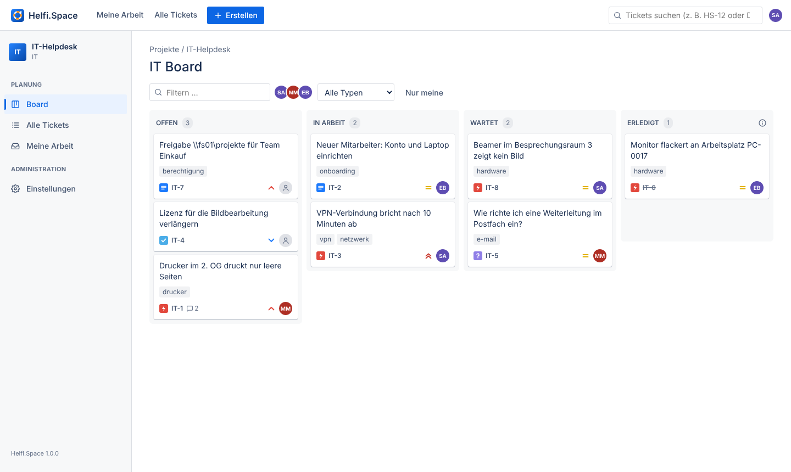
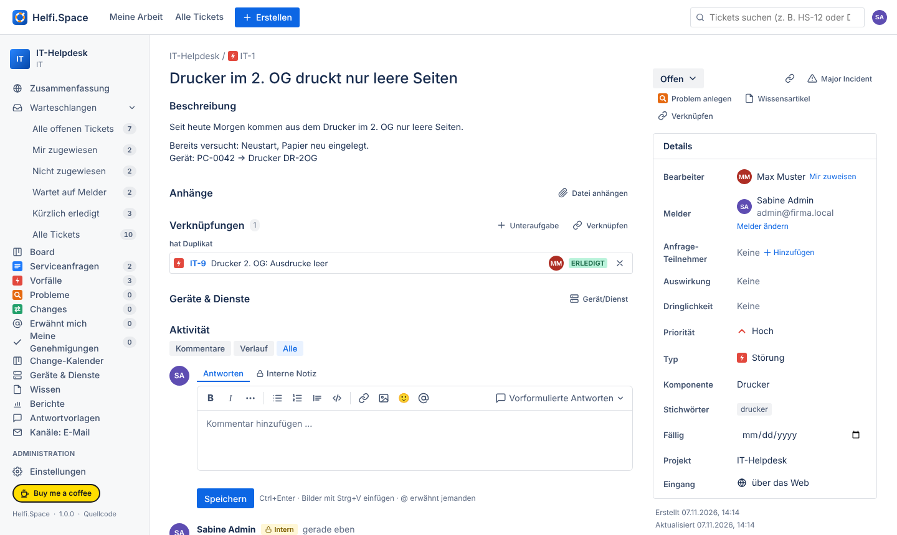
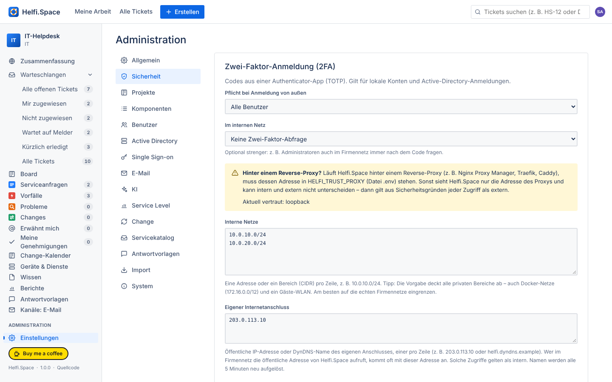

<p align="center"></p>

# Helfi.Space

**Deutsch** · [English](README.en.md) · [helfi.space](https://helfi.space)

Ein schlankes Ticketsystem für IT-Abteilungen und Institute, auf Deutsch und Englisch. Helfi.Space läuft als ein einzelner Docker-Container mit SQLite.



- **Active Directory** (Windows Server oder Samba AD): Anmeldung mit Windows-Konten, Rollen über AD-Gruppen (auch verschachtelt), **LDAPS-Zertifikat per Knopfdruck abrufen**
- **Single Sign-on** über OpenID Connect: Microsoft Entra ID, ADFS, Keycloak, Authentik …
- **E-Mail → Ticket:** Ein Postfach wird per IMAP abgerufen, neue Mails werden zu Tickets und Antworten landen im passenden Ticket. Melder bekommen Antworten per E-Mail.
- **Übersichtlich:** Seitenleiste mit Warteschlangen (offen, mir zugewiesen, nicht zugewiesen, wartet, kürzlich erledigt, alle) samt Live-Zahlen, Zusammenfassung je Projekt, Board mit Drag & Drop, Ticketliste mit Filtern, Ticketansicht mit Details, Kommentaren, internen Notizen, Anhängen und Verlauf
- **Import aus einem anderen Ticketsystem** (über dessen REST-API, Cloud und Server/Data Center): Projekte, Tickets, Kommentare und Anhänge. Die Ticketnummern bleiben erhalten.
- **Screenshots einfügen:** Bilder aus der Zwischenablage mit Strg+V direkt in Kommentar, Beschreibung oder „Ticket erstellen“. In internen Notizen bleiben sie intern.
- **IT-Service-Management nach ITIL** (alles optional): Verknüpfungen und Unteraufgaben, Auswirkung/Dringlichkeit und Major Incidents, Service Level, Probleme und bekannte Fehler, Change-Management mit Genehmigung und Kalender, Wissensdatenbank, Servicekatalog mit Formularen und Genehmigung, Geräte & Dienste, Zufriedenheitsumfrage und Kennzahlen
- **Rollen:** Administrator, Bearbeiter, Benutzer. Benutzer sehen nur ihre eigenen Anfragen.
- **Zwei-Faktor-Anmeldung (TOTP):** Im internen Netz reicht das Kennwort, von außen ist der Code aus einer Authenticator-App Pflicht – einstellbar je Rolle.
- **Lokaler Notfall-Admin:** Er wird bei der Ersteinrichtung angelegt und funktioniert auch, wenn das AD nicht erreichbar ist.
- **Neuigkeiten:** Nach einem Update zeigt Helfi.Space jedem einmal, was sich für ihn geändert hat; alle Versionen stehen im Benutzermenü unter *Neuigkeiten*.
- Automatische Sicherungen täglich und vor jedem Update



**Handbuch (PDF):** [Deutsch](docs/Handbuch.pdf) · [English](docs/Manual.en.pdf) – für Benutzer, Bearbeiter und Administratoren.

---

## Installation

Voraussetzung: Docker mit Compose (Linux-Server, Synology, …).

```sh
mkdir helfi && cd helfi
# docker-compose.yml, env.example und update.sh aus dem neuesten Release herunterladen
cp env.example .env
nano .env            # mindestens HELFI_BASE_URL anpassen
docker compose up -d
docker compose logs helfi   # zeigt den Einrichtungscode
```

Dann `HELFI_BASE_URL` im Browser öffnen. Der Einrichtungsassistent fragt nach dem **Einrichtungscode** aus dem Protokoll und legt den **lokalen Administrator** und das erste Projekt an. Danach geht es direkt zur AD-Einrichtung.

> **Repository noch privat?** Dann braucht der Server einmalig eine Anmeldung bei ghcr.io:
> `docker login ghcr.io -u <GitHub-Name>` mit einem Personal Access Token (Recht `read:packages`).

Auf dem Host liegen nur vier Dinge:

| | |
|---|---|
| `docker-compose.yml` | bleibt bei Updates in der Regel gleich |
| `update.sh` | Update von Hand (optional, bei Container-Verwaltung nicht nötig) |
| `.env` | deine Einstellungen (Adresse, Port, Version, PUID/PGID) |
| `data/` | Datenbank, Anhänge, Sicherungen, Schlüsseldatei |

**Synology:** In der `.env` `PUID`/`PGID` auf deinen Benutzer setzen (z. B. `1026`/`100`, siehe `id` per SSH), damit die Dateien in `data/` dir gehören.

### HTTPS (empfohlen)

Helfi.Space selbst spricht HTTP auf Port 8080. Für den Betrieb gehört ein Reverse-Proxy mit HTTPS davor (Synology-Reverse-Proxy, Nginx Proxy Manager, Caddy, Traefik …). Danach `HELFI_BASE_URL=https://helfi.firma.local` setzen. Cookies werden dann automatisch als `Secure` markiert.

Damit die Bremse gegen Kennwort-Raten die echte Client-Adresse sieht, trägst du in der `.env` die Adresse des Proxys ein, z. B. `HELFI_TRUST_PROXY=10.0.10.5`. Mehrere Angaben trennst du mit Komma, z. B. `loopback, 10.0.10.5`. Ohne diesen Eintrag glaubt Helfi.Space `X-Forwarded-For` nur vom eigenen Rechner (`loopback`), weil sich die Angabe sonst fälschen ließe. Werte wie `true` oder eine Zahl (Anzahl der Proxys) werden mit einer Warnung im Protokoll ignoriert; dann gilt ebenfalls `loopback`.

Beispiel Caddy:

```
helfi.firma.local {
    reverse_proxy 10.0.10.20:8080
}
```

---

## Erscheinungsbild (Corporate Design)

*Administration → Allgemein → Erscheinungsbild*:

- **Logo** als PNG oder SVG (höchstens 512 KB). Es ersetzt das Logo in der Kopfzeile, auf der Anmeldeseite und im Browser-Tab. SVGs mit Skripten oder Verweisen auf fremde Inhalte werden abgelehnt. Das Logo liegt im Datenordner unter `brand/` und wird mitgesichert.
- **Titel neben dem Logo** lässt sich ausblenden, wenn das Logo den Namen schon enthält.
- **Hauptfarbe** für Knöpfe, Links und Markierungen. Die Seite zeigt den Kontrast zu Weiß an und warnt unter 4,5:1, weil Schrift auf Knöpfen dann schlecht lesbar ist.
- **Kopfzeile** hell oder in der Hauptfarbe. Bei sehr hellen Farben wird die Schrift dort automatisch dunkel.
- Eine Vorschau zeigt die Wirkung vor dem Speichern; *Auf Standard zurücksetzen* stellt alles wieder her.

## Anmeldeseite anpassen

*Administration → Allgemein → Anmeldeseite*: eigene Überschrift (z. B. „Hilfecenter“), Begrüßungstext auf Deutsch und optional Englisch, z. B. wie man Hilfe bekommt, und eine eigene Bezeichnung für das Anmeldefeld („Windows-Anmeldename“). Nur Text: `**fett**`, Links und Mailadressen werden automatisch anklickbar, HTML wird nie ausgeführt. Eine Vorschau zeigt das Ergebnis sofort.

## Active Directory einrichten

*Administration → Active Directory*

1. **Domänencontroller** eintragen, und zwar mit dem Namen, der im Zertifikat steht (z. B. `dc01.firma.local`). Verschlüsselung: **LDAPS (636)** oder **StartTLS (389)**.
2. **Zertifikat abrufen** holt das Zertifikat direkt vom DC und zeigt den SHA-256-Fingerabdruck. Vergleiche ihn mit dem am Server und klicke dann **Zertifikat übernehmen**.
   - Windows: `certlm.msc` → Eigene Zertifikate → Zertifikat des DCs → Details → Fingerabdruck (SHA-256 über PowerShell: `Get-ChildItem Cert:\LocalMachine\My | Format-List Subject, @{n='SHA256';e={$_.GetCertHashString('SHA256')}}`)
   - Samba: `openssl x509 -in /var/lib/samba/private/tls/cert.pem -noout -fingerprint -sha256`
3. **Dienstkonto** eintragen, z. B. `svc-helfi@firma.local` (normales Domänenkonto, keine besonderen Rechte nötig). Ohne Dienstkonto sucht Helfi.Space mit dem Konto, das sich gerade anmeldet, und prüft das Kennwort danach noch einmal am gefundenen Konto (so führt der UPN eines anderen Kontos nie zur falschen Anmeldung).
4. **Gruppen** für Administratoren und Bearbeiter eintragen, z. B. `Helfi-Admins` und `Helfi-Bearbeiter` (Name oder vollständiger DN). Verschachtelte Gruppen werden berücksichtigt. Optional lässt sich über eine Gruppe „Zugelassene Benutzer“ einschränken, wer sich überhaupt anmelden darf (Admins und Bearbeiter dürfen immer). Ist ein Gruppenname mehrdeutig (gleicher Name in mehreren OUs), wird keine Rolle vergeben und das Protokoll meldet es – dann den vollständigen DN eintragen.
5. **Verbindung testen**, am besten mit einer Testanmeldung. Ist der Base-DN leer, wird er dabei aus dem AD übernommen. Gibt es eine Microsoft-Zertifizierungsstelle (AD CS), findet der Test sie und bietet an, sie mit zu übernehmen. Dann bleiben auch erneuerte DC-Zertifikate automatisch gültig.
6. **AD-Anmeldung aktivieren** und speichern.

Angemeldet wird mit `m.muster`, `FIRMA\m.muster` oder `m.muster@firma.local`. Benutzer werden bei der ersten Anmeldung angelegt. Ihre Rolle ergibt sich bei jeder Anmeldung aus den Gruppen, außer ein Admin hat sie unter *Benutzer* mit „Rolle fest“ gesperrt. Ändert ein Admin die Rolle von Hand, wird sie automatisch gesperrt.

**Gut zu wissen**

- Ein Windows-DC bietet LDAPS nur an, wenn er ein Zertifikat hat (AD CS oder manuell installiert). Samba AD erzeugt beim Einrichten selbst eines.
- Täglich prüft Helfi.Space, ob das hinterlegte Zertifikat noch passt und ob es bald abläuft. Probleme erscheinen als Hinweis für Admins. Nach einer Erneuerung am DC genügt erneut **Zertifikat abrufen**.
- **Teilnehmer aus dem AD vorschlagen** (Standard: an, braucht das Dienstkonto): siehe [Anfrage-Teilnehmer](#anfrage-teilnehmer).
- Lokale Konten haben Vorrang: Gibt es ein lokales Konto mit demselben Namen wie ein AD-Konto, gilt das lokale.
- Ist das AD nicht erreichbar, können sich lokale Konten (der Notfall-Admin) weiterhin anmelden.

## Zwei-Faktor-Anmeldung (2FA)

*Administration → Sicherheit*

Standard: **Im internen Netz reicht das Kennwort, von außen ist ein zweiter Faktor Pflicht.** Das ist ein 6-stelliger Code aus einer Authenticator-App wie Microsoft Authenticator, Google Authenticator, Aegis oder 2FAS. Die Pflicht lässt sich getrennt nach Rolle einstellen:

| Einstellung | Auswahl |
|---|---|
| Pflicht bei Anmeldung von außen | alle Benutzer (Standard) · Bearbeiter und Administratoren · nur Administratoren · niemand |
| Im internen Netz | keine Zwei-Faktor-Abfrage (Standard) · nur Administratoren · Bearbeiter und Administratoren · alle Benutzer |

Beispiel: Melder ohne Code, Bearbeiter von außen mit Code, Administratoren immer mit Code. Wer vorher „immer“ oder „nie“ eingestellt hatte, behält das Verhalten.

- **Zugriffe vom Server selbst** (127.0.0.1) gelten nicht automatisch als intern. Ein Reverse-Proxy auf demselben Rechner muss X-Forwarded-For setzen, sonst sähe jeder Zugriff wie vom Server selbst aus. Zum Testen lässt sich `127.0.0.1` in die Liste eintragen.
- **Interne Netze** stehen in den Einstellungen, eine Angabe pro Zeile (Standard: `10.0.0.0/8`, `172.16.0.0/12`, `192.168.0.0/16`, `fc00::/7`). Die Vorgabe deckt alle privaten Bereiche ab, auch Docker-Netze und ein Gäste-WLAN. Am besten auf die echten Firmennetze eingrenzen, z. B. `10.0.10.0/24`. Die Seite zeigt an, wie deine aktuelle Adresse erkannt wird.
- **Eigener Internetanschluss:** Ruft ein Rechner im Firmennetz Helfi.Space über die öffentliche Adresse auf, kommt er oft mit der öffentlichen IP des eigenen Anschlusses an (Hairpin-NAT). Diese IP oder einen DynDNS-Namen (z. B. `203.0.113.10` oder `helfi.dyndns.example`) dort eintragen, dann gelten solche Zugriffe als intern. Namen werden alle 5 Minuten neu aufgelöst; ist DNS kurz nicht erreichbar, gilt die zuletzt bekannte Adresse weiter. Achtung: Hängt ein Gäste-WLAN am selben Anschluss, gelten auch Gäste als intern.
- **Hinter einem Reverse-Proxy** muss dessen Adresse in `HELFI_TRUST_PROXY` stehen. Sonst sieht Helfi.Space nur den Proxy und behandelt jeden Zugriff sicherheitshalber als extern. Admins bekommen dann einen Hinweis.
- **Einrichten:** Jeder richtet 2FA unter *Profil → Zwei-Faktor-Anmeldung* ein: QR-Code scannen, Code eingeben, 10 Wiederherstellungscodes sichern. Aus Sicherheitsgründen geht die Ersteinrichtung nur im internen Netz, und zwar in jedem Modus. Ausnahme: nach einer SSO-Anmeldung, deren zweiten Faktor der Identitätsanbieter geprüft hat („SSO-Anmeldungen gelten als zweiter Faktor“). Ist 2FA schon eingerichtet, lässt sie sich nur mit gültigem Code abschalten und dann neu einrichten (z. B. neues Handy). So kann niemand mit einem erbeuteten Kennwort von außen seinen eigenen zweiten Faktor hinterlegen. Wer nur von außen arbeitet, für den lässt sich unter *Sicherheit* die „Ersteinrichtung auch von außen“ erlauben.
- **Sitzungen:** Wer sich im Büro ohne Code angemeldet hat und denselben Browser später von zu Hause nutzt, muss sich dort neu mit Code anmelden. Eine Sitzung endet nach `HELFI_SESSION_HOURS` (Standard 12 Stunden) ohne Nutzung und spätestens 30 Tage nach der Anmeldung, auch bei ständiger Nutzung.
- **Handy verloren:** Mit einem Wiederherstellungscode anmelden. Alternativ setzt ein Admin unter *Benutzer → 2FA zurücksetzen* die 2FA zurück, und die Person richtet sie im Büro neu ein.
- **Gilt für** lokale Konten und Active-Directory-Anmeldungen. Bei **SSO** regelt *Sicherheit → SSO-Anmeldung als zweiter Faktor*, ob die Anmeldung beim Identitätsanbieter reicht:
  - **Nur wenn der Anbieter eine MFA meldet** (Standard): Das Token muss eine Mehrfaktor-Anmeldung belegen, also `amr` mit z. B. `mfa`, `otp` oder `hwk` (Entra ID: `mfa`), oder einen der unter *Single Sign-on → acr-Werte für MFA* eingetragenen `acr`-Werte (z. B. Keycloak-Stufe `2`). Sonst fragt Helfi.Space seinen eigenen Code ab.
  - **Immer** oder **Nie** (dann immer zusätzlich der eigene Code).
  - Installationen mit aktivem SSO behalten beim Update ihr bisheriges Verhalten („Immer“); unter *Sicherheit* steht dann ein Hinweis mit der Empfehlung.
- Docker-Hinweis: Bei manchen Docker-Setups kommen alle Zugriffe scheinbar vom Docker-Gateway, z. B. bei rootless Docker oder IPv6. Diese Adresse gilt deshalb nur als intern, wenn sie einzeln eingetragen ist.



## Single Sign-on (OpenID Connect)

*Administration → Single Sign-on*

1. Beim Anbieter eine App bzw. einen Client anlegen und als Umleitungs-URI die angezeigte Adresse eintragen: `https://helfi.firma.local/auth/oidc/callback`.
2. Issuer-URL, Client-ID und Client-Geheimnis eintragen und **Testen**.
   - **Microsoft Entra ID:** `https://login.microsoftonline.com/<Mandanten-ID>/v2.0`. Unter *Tokenkonfiguration* den Gruppenanspruch hinzufügen. Im Token stehen dann Gruppen-IDs, und diese IDs trägst du bei Admin-/Bearbeiter-Gruppe ein.
   - **ADFS (Windows Server):** `https://adfs.firma.local/adfs`, Anwendungsgruppe „Serveranwendung, die auf eine Web-API zugreift“. Den Anspruch `groups` per Anspruchsregel ausgeben.
   - **Keycloak:** `https://keycloak.firma.local/realms/<Realm>`, Mapper „Group Membership“ mit Claim `groups`.
3. Optional „direkt zu SSO weiterleiten“ einschalten. Die normale Anmeldeseite bleibt dann über `/login?local=1` erreichbar, etwa für den Notfall-Admin.

**SSO und AD zusammen:** Trägst du bei „Mit AD-Konten zusammenführen für Domäne“ deine Domäne ein (z. B. `firma.local`), ist `m.muster@firma.local` aus dem SSO dasselbe Konto wie der AD-Benutzer `m.muster`. Trag die Domäne nur ein, wenn der Anbieter sie wirklich kontrolliert, also keine Gastkonten aus anderen Organisationen zulässt. Ohne Eintrag bleiben SSO-Konten getrennt, und ein Gast `m.muster@fremd.example` kann nie das Konto `m.muster` übernehmen. Steht im Token kein Anmeldename (`preferred_username`/UPN), sondern nur die E-Mail-Adresse, wird nur zusammengeführt, wenn der Anbieter sie als bestätigt meldet (`email_verified`). E-Mail-Adressen aus dem SSO werden nur übernommen und mit E-Mail-Kontakten zusammengeführt, wenn der Anbieter sie als bestätigt meldet oder wenn sie gleich dem Anmeldenamen der freigegebenen Domäne sind (z. B. Entra ID: UPN = Mailadresse).

**Stabile Zusammenführung über die AD-Kennung (empfohlen):** Bei manchen Anbietern (z. B. Keycloak, Authentik) ist der Anmeldename frei wählbar. Trag deshalb unter *Claim mit AD-Kennung* den Claim ein, der die `objectSid` oder `objectGUID` des AD-Kontos enthält: bei Entra ID den optionalen Claim `onprem_sid`, bei Keycloak oder Authentik ein eigenes Mapping auf `objectGUID` (als Text mit Bindestrichen, Hex oder Base64). Dann wird **nur** darüber zusammengeführt, nicht mehr über Namen und Domäne. Mit Dienstkonto prüft Helfi.Space bei jeder SSO-Anmeldung das AD-Konto wie bei einer Kennwort-Anmeldung: deaktiviert oder nicht mehr in der Gruppe „Zugelassene Benutzer“ heißt kein Zugang, die Rolle folgt den AD-Gruppen, und ein noch unbekanntes AD-Konto wird angelegt (außer „Nur vorhandene Konten“ ist eingestellt). Ist das AD gerade nicht erreichbar, wird die SSO-Anmeldung abgebrochen, statt ein getrenntes Konto anzulegen. Ein früher getrenntes SSO-Konto derselben Person bleibt liegen, angemeldet wird ab dann das AD-Konto. Fehlt der Claim im Token oder gibt es die Person im AD nicht, bleibt das SSO-Konto getrennt.

## E-Mail

*Administration → E-Mail*

- **Postfach abrufen (IMAP):** Server, Benutzer und Kennwort des Helpdesk-Postfachs eintragen. Neue Mails werden zu Tickets (inklusive Anhängen bis 20 MB je Anhang und bis zu 30 Anhängen; was nicht übernommen wird, steht als Hinweis im Ticket; Mails über 80 MB werden übersprungen und im Postfach markiert). Antworten auf Mails von Helfi.Space und Antworten Beteiligter mit `[IT-123]` im Betreff werden zu Kommentaren, zitierter Verlauf wird abgeschnitten. Antwortet der Melder auf ein wartendes oder erledigtes Ticket, wird es wieder geöffnet. Abwesenheitsnotizen und automatische Mails werden ignoriert. Verarbeitete Mails werden gelesen markiert oder in einen Ordner verschoben. Übersprungene Mails (automatisch erzeugt, Stundengrenze, Konto deaktiviert, ohne gültigen Absender, eigene Adresse, Regel „Ignorieren“) und Unzustellbarkeitsberichte bleiben gelesen im Posteingang; sie kommen nicht in den Ordner für verarbeitete Mails und werden deshalb auch nicht automatisch gelöscht.
- **Versand (SMTP):** Als Absender am besten dieselbe Adresse wie das Postfach verwenden, dann landen Antworten wieder im Ticket.
- **Interne Notizen** gehen nie per E-Mail raus.
- Per Ticketnummer im Betreff dürfen nur Beteiligte antworten: der Melder, Anfrage-Teilnehmer und alle, die schon im Ticket geschrieben haben. Der zugewiesene Bearbeiter zählt nicht automatisch dazu. Wer die Nummer nur errät, bekommt ein eigenes neues Ticket. Antworten auf Mails von Helfi.Space werden über die Message-ID immer richtig zugeordnet.
- Wird eine Antwort nur über die Nummer im Betreff zugeordnet, werden ihre An/CC-Empfänger nicht Teilnehmer. Das geschieht nur bei neuen Tickets und bei Antworten auf Mails von Helfi.Space (Bezug über die Message-ID).
- Absenderadressen lassen sich fälschen. Deshalb gilt eine Mail nie als Bearbeiter-Antwort, auch wenn sie von der Adresse eines Bearbeiters kommt: Sie erscheint mit der Absenderadresse, nicht unter dem Konto, und wird nicht an den Melder weitergeleitet. Bearbeiter antworten über die Weboberfläche.
- Antworten per Mail auf Zuweisungs-, SLA- oder Genehmigungsmails an Bearbeiter werden interne Notizen und öffnen das Ticket nicht wieder.
- Helfi.Space merkt sich verarbeitete Mails mit einem eigenen IMAP-Kennzeichen (`$HelfiDone`). Liest jemand das Postfach parallel in Outlook oder auf dem Handy, werden die Mails trotzdem verarbeitet. Kann der Mailserver keine eigenen Kennzeichen speichern, holt Helfi.Space wie früher nur ungelesene Mails – dann das Postfach nicht parallel lesen. Empfohlen ist ein Ordner für verarbeitete Mails.
- Eingangsbestätigungen gehen höchstens 60-mal pro Stunde raus (Schutz vor Missbrauch mit gefälschten Absendern).
- Schleifenschutz: Mehr als 20 neue Tickets pro Stunde vom selben Absender werden ignoriert.
- **Schutz vor Mail-Schleifen** (z. B. mit Monitoren, Druckern, Backup-Software):
  - Unzustellbarkeitsberichte (Exchange, Postfix, …) und Lesebestätigungen werden nie zu Tickets oder Kommentaren und nie beantwortet.
  - Gehört ein Bericht zu einer Mail von Helfi.Space, erscheint im Ticket eine interne Notiz „Zustellung fehlgeschlagen“.
  - Die betroffene Adresse bekommt 7 Tage lang keine Mails mehr. Gesperrt werden nur Adressen aus echten Kopfzeilen des Berichts (`X-Failed-Recipients`) bzw. aus seinem Teil `message/delivery-status`, nie Adressen aus dem Mailtext. Die Liste steht unter *Administration → E-Mail → Gesperrte Empfänger*, dort lässt sich eine Adresse auch vorzeitig freigeben.
  - **Absender-Regeln** (Adresse oder Muster wie `*@zabbix.firma.local`): „Ticket anlegen, nie antworten“, wahlweise in ein eigenes Projekt, oder „Ignorieren“. Automatisch erzeugte Mails (Kopfzeile `Auto-Submitted`, `Precedence: bulk`, Absender `noreply@…`), wie sie Proxmox, NAS-Systeme oder Monitoring verschicken, werden nur mit der Regel „Ticket anlegen, nie antworten“ angenommen. Ohne Regel werden sie übersprungen. Unter *Administration → E-Mail* steht bei den zuletzt übersprungenen Mails jeweils Absender und Grund.
- Absender ohne Konto werden als *E-Mail-Kontakt* geführt. Melden sie sich später per AD oder SSO mit derselben Adresse an, werden ihre Tickets übernommen.
- **Absender im AD nachschlagen** (Standard: an, braucht AD-Anmeldung mit Dienstkonto): Unbekannte Absender sucht Helfi.Space im AD. Gesucht wird in `mail`, `userPrincipalName` und den Zweitadressen in `proxyAddresses`, deaktivierte Konten nicht. Bei genau einem Treffer wird die Person gleich als AD-Benutzer angelegt, mit der Rolle aus ihren Gruppen, als hätte sie sich angemeldet. Ein vorhandener E-Mail-Kontakt wird dabei übernommen. Nicht gefunden, mehrdeutig oder AD nicht erreichbar: Sie wird wie bisher E-Mail-Kontakt. Unbekannte Adressen werden eine Stunde lang nicht erneut gesucht. Eine Mail gibt auch dann nie Bearbeiter-Rechte.
- **Aufbewahrung:** „Verarbeitete Mails löschen nach … Tagen“ (Standard 0 = nie, sonst mindestens 7). Einmal täglich werden im Ordner für verarbeitete Mails die älteren Mails endgültig gelöscht, höchstens 500 pro Lauf. Im Posteingang wird nie gelöscht. Ist kein eigener Ordner eingetragen, löscht Helfi.Space gar nichts. Die Inhalte bleiben in den Tickets.

### HTML-Mails

Mails im HTML-Format zeigt Helfi.Space bei Beschreibung und Antworten **formatiert** an, mit Tabellen, Fettdruck, Farben, Signatur und eingebetteten Bildern. Ein Umschalter **„Formatiert | Text“** wechselt zur Textfassung; die Wahl merkt sich der Browser. Bearbeitet wird immer die Textfassung. Nach dem Bearbeiten einer Beschreibung gilt nur noch der Text.

- **Sicherheit:** Das HTML wird beim Empfang bereinigt. Skripte, Formulare, eingebettete Seiten, Ereignis-Attribute und `javascript:`-Links werden entfernt. Angezeigt wird es zusätzlich in einem abgeschotteten Rahmen mit eigener Sicherheitsrichtlinie, in dem kein Skript laufen kann.
- **Bilder:** Eingebettete Bilder wie Logos, Signaturen oder eingefügte Screenshots werden angezeigt. Kleine Logos tauchen nicht in der Anhangsliste auf. **Bilder aus dem Internet** (oft Zählpixel) werden nie geladen; ein Hinweis nennt ihre Anzahl.
- **Antworten:** Der zitierte Verlauf (Outlook, Gmail, Apple Mail, Thunderbird) ist eingeklappt: „Zitierten Text anzeigen“.
- Gilt für Mails, die nach dem Update eingehen.

## Suche

Das Suchfeld oben durchsucht alle Tickets im Volltext: Titel, Beschreibung, Antworten, Stichwörter und Namen der Anhänge. Bearbeiter finden zusätzlich interne Notizen und die beteiligten Personen (Melder, Bearbeiter, Antwortende, auch über Mailadresse und Anmeldenamen). Benutzer ohne Bearbeiter-Rolle finden Tickets über Titel, Beschreibung, öffentliche Antworten, Namen der Anhänge, Stichwörter und die Namen, die sie im Ticket auch sehen (Melder, Bearbeiter, Antwortende) – nie über interne Notizen, Mailadressen oder Anmeldenamen.

- **Wortteile** werden gefunden: `drucker` findet auch „Netzwerkdrucker“. Groß- und Kleinschreibung spielt keine Rolle.
- **Mehrere Wörter** in beliebiger Reihenfolge müssen alle vorkommen, `"genaue Folge"` in Anführungszeichen, `-wort` schließt aus.
- **Beste Treffer zuerst:** Titeltreffer zählen am meisten. Ein Klick auf eine Spalte sortiert wie gewohnt, „Beste Treffer zuerst“ stellt zurück.
- **Fundstelle:** unter jedem Treffer steht ein Ausschnitt mit markierten Wörtern und woher er stammt (Beschreibung, Antwort von …, Anhang).
- Eine Ticketnummer wie `HELP-123` springt direkt zum Ticket. Der Suchindex wird beim ersten Start nach dem Update einmal aufgebaut (bei 7000 Tickets unter einer Sekunde) und danach laufend nachgeführt.

## Anfrage-Teilnehmer

Neben dem Melder können weitere Personen an einem Ticket beteiligt sein, z. B. Kollegen mit demselben Problem oder die Vorgesetzte.

- **Hinzufügen:** in der Ticketansicht unter *Anfrage-Teilnehmer → Hinzufügen*.
  - Bearbeiter suchen nach Name oder tragen eine beliebige E-Mail-Adresse ein. Die Vorschläge erscheinen beim Tippen, der Cursor bleibt im Feld; auswählen mit Klick oder ↑/↓ und Enter, Esc bricht ab.
  - **Aus dem AD:** Bearbeiter sehen ab 3 Zeichen auch Personen aus dem AD (markiert mit „AD“), gesucht in Name, Anmeldename und Mailadressen samt Zweitadressen. Wer gewählt wird, wird als AD-Benutzer angelegt bzw. aktualisiert, mit Mailadresse und Rolle aus dem AD; ein vorhandener E-Mail-Kontakt wird übernommen. Auch eine eingetippte Mailadresse wird im AD nachgeschlagen. Personen, die laut Gruppen Helfi.Space nicht nutzen dürfen, kommen als E-Mail-Kontakt dazu. Ist das AD nicht erreichbar, erscheinen nur die vorhandenen Personen. Abschaltbar unter *Administration → Active Directory → Teilnehmer aus dem AD vorschlagen*, braucht das Dienstkonto.
  - Melder und Teilnehmer können Kollegen mit eigenem Konto hinzufügen, aber keine freien Adressen.
  - Höchstens 20 je Ticket.
- **Per E-Mail:** Wer bei einer neuen Mail oder einer Antwort auf eine Mail von Helfi.Space in *An* oder *CC* steht, wird automatisch Teilnehmer (nicht, wenn eine Antwort nur über die Nummer im Betreff zugeordnet wird). Das gilt für höchstens 10 Adressen je Mail; die eigene Helpdesk-Adresse und Bearbeiter zählen nicht mit. Abschaltbar unter *Administration → E-Mail*.
- **Was Teilnehmer dürfen:**
  - das Ticket sehen, auch unter *Meine Anfragen* mit dem Filter „Ich bin Teilnehmer“
  - im Web oder per Antwort-Mail kommentieren und Dateien anhängen
- **Was Teilnehmer nicht dürfen:** interne Notizen sehen, Status, Zuweisung oder Titel ändern. Vom Melder sehen sie nur den Namen, nicht Mailadresse und Anmeldenamen (das gilt auch für Genehmigende ohne Bearbeiter-Rolle).
- **Absender ist immer das Ticketsystem** (keine Adressen oder Signaturen von Bearbeitern). Antwort- und Erledigt-Mails enden mit „Viele Grüße“, dem Namen des Bearbeiters und dem Namen des Systems; ist das Ticket jemand anderem zugewiesen, steht „Ihr Ansprechpartner: …“ dabei.
- **Benachrichtigungen:** Teilnehmer bekommen dieselben Mails wie der Melder (Antworten, Erledigt), jeder einzeln in seiner Sprache, ohne die Adressen der anderen. Wer im Web hinzugefügt wird, bekommt eine kurze Mail.
- **Entfernen:** Bearbeiter, der Melder oder die Person selbst.

## Mehrere Tickets auf einmal bearbeiten

In *Alle Tickets* (Bearbeiter):
- **Auswählen:** Kästchen vor jeder Zeile, „alle“ im Kopf, Umschalt+Klick für einen Bereich, `x` für das mit `j`/`k` markierte Ticket.
- **Aktionsleiste:**
  - **Erledigen:** optional mit einer Antwort an Melder und Teilnehmer, mit Vorlagen und Platzhaltern je Ticket. Mit Antwort gibt es keine zusätzliche „Erledigt“-Mail.
  - **Status**, **Zuweisen**, **Priorität**
  - **In ein anderes Projekt verschieben**
- Jede Änderung landet im Verlauf des Tickets. Klappt ein Ticket nicht, laufen die anderen trotzdem durch, und die Meldung nennt es.

**Tickets werden nie gelöscht**, auch nicht von Admins, damit der Verlauf nachweisbar bleibt. Was erledigt ist, wird auf „Erledigt“ gesetzt. Gegen Spam hilft eine Absender-Regel „Ignorieren“. Ein Projekt lässt sich nur löschen, wenn seine Tickets dabei in ein anderes Projekt verschoben werden. Soll es samt Tickets erhalten bleiben, archiviert man es stattdessen.

## Verknüpfungen und Unteraufgaben

In der Ticketansicht (Bearbeiter) unter *Verknüpfungen*:

- **Verknüpfen:** „bezieht sich auf“, „ist Duplikat von“, „blockiert“ / „wird blockiert von“, „verursacht“ / „wird verursacht durch“, „ist Unteraufgabe von“ / „hat Unteraufgabe“. Die Gegenseite sieht die Verknüpfung automatisch, beide Tickets bekommen einen Verlaufseintrag. Bei „ist Duplikat von“ lässt sich das Ticket gleich auf „Erledigt“ setzen.
- **Unteraufgaben:** direkt anlegen (Aufgabe im selben Projekt) oder bestehende Tickets unterordnen. Ein Fortschrittsbalken zeigt „x von y erledigt“. Ein Ticket hat höchstens ein übergeordnetes Ticket, Kreise werden abgelehnt.
- Verknüpfungen sehen nur Bearbeiter; höchstens 50 je Ticket.

## Auswirkung, Dringlichkeit und Major Incident

- **Priorität nach ITIL:** In den Details setzen Bearbeiter *Auswirkung* und *Dringlichkeit* (hoch/mittel/niedrig). Sind beide gesetzt, ergibt sich die Priorität aus der Matrix (z. B. hoch × hoch = Sehr hoch, mittel × mittel = Mittel). Von Hand lässt sie sich weiterhin ändern.
- **Major Incident:** Eine Störung mit vielen Betroffenen über den Knopf *Major Incident* kennzeichnen. Alle Bearbeiter sehen sie oben als roten Hinweis. Betroffene Tickets hängst du über *Verknüpfen → verursacht* an. **Info an alle Betroffenen** schreibt dieselbe Antwort in den Major Incident und alle offenen betroffenen Tickets, sodass jeder Melder und Teilnehmer sie per Mail bekommt. Optional werden danach alle auf „Erledigt“ gesetzt.

## Service Level (SLA)

*Administration → Service Level* (standardmäßig aus):

- **Ziele je Priorität** für die **erste Reaktion** (erste öffentliche Antwort eines Bearbeiters) und die **Lösung**, in Geschäftsstunden. Vorgabe: Sehr hoch 0,5 / 4 Std, Hoch 2 / 16, Mittel 8 / 40, Niedrig 16 / 80.
- **Geschäftszeiten** (Wochentage, Beginn, Ende) und **Feiertage** (eine Zeile je Tag, `2026-12-24 Heiligabend`). Außerhalb läuft keine SLA-Zeit; maßgeblich ist die Zeitzone `TZ` des Containers.
- **„Wartet“ hält die Lösungszeit an** (abschaltbar).
- Gilt für Störungen, Anfragen und Fragen von Benutzern, nicht für Aufgaben und eigene Tickets der Bearbeiter und nicht für importierte Tickets.
- **Anzeige:** In der Ticketansicht stehen beide Uhren mit Restzeit, grün, gelb ab 80 % (einstellbar) und rot bei Überschreitung. In der Ticketliste gibt es eine SLA-Spalte, in der Seitenleiste die Ansicht **SLA gefährdet** mit Zähler.
- **Warnung:** Bei Erreichen der Warnschwelle und bei Überschreitung bekommt der Bearbeiter eine Mail (ohne Bearbeiter die Projektleitung), jeweils einmal. Der Verlauf hält es fest.

## Problem-Management

- **Problem anlegen:** In einer Störung über *Problem anlegen*. Das Problem wird gleich mit der Störung verknüpft. Probleme legen nur Bearbeiter an; die Seitenleiste zeigt offene **Probleme** mit Zähler.
- **Felder:** *Ursache*, *Workaround* und **Bekannter Fehler** (Ursache und Workaround sind bekannt, die endgültige Lösung steht noch aus).
- **Betroffene Störungen** hängen über *Verknüpfen → verursacht* am Problem. Dort sehen Bearbeiter oben „Ursache bekannt“ mit dem Workaround und übernehmen ihn mit einem Klick in die Antwort.
- **Störungen informieren:** schreibt dieselbe Antwort in alle offenen betroffenen Störungen, z. B. wenn die Lösung eingespielt ist.

## Change-Management

Tickettyp **Change** (nur Bearbeiter), mit eigenem Abschnitt im Ticket:

- **Arten:**
  - **Normal:** braucht eine Genehmigung.
  - **Standard:** vorab genehmigte Routine nach einer Vorlage, ohne Genehmigung.
  - **Notfall:** sofort umsetzen, Genehmigung nachträglich.
- **Felder:** Grund, Risiko, betroffene Dienste und Geräte, geplanter Beginn und geplantes Ende, Umsetzungs-, Rückfall- und Testplan.
- **Ablauf:** Entwurf → Zur Genehmigung → Genehmigt/Abgelehnt → Geplant → In Umsetzung → Überprüfung → Abgeschlossen. Der Ticketstatus folgt automatisch. Fehlende Pflichtangaben nennt Helfi.Space beim jeweiligen Schritt.
- **Genehmigung (CAB):** Genehmiger und Regel („eine Zustimmung genügt“ oder „alle müssen zustimmen“) unter *Administration → Change*. Genehmiger bekommen eine Mail und entscheiden im Ticket (mit Kommentar) oder über die Ansicht **Meine Genehmigungen**. Jede Entscheidung steht im Verlauf. Nach einer Ablehnung lässt sich der Change überarbeiten und neu vorlegen.
- **Vorlagen für Standard-Changes** (z. B. Firmware-Update) unter *Administration → Change*, im Change mit einem Klick übernommen.
- **Abschluss:** Ergebnis „Erfolgreich“, „Mit Problemen“ oder „Zurückgerollt“. Bei den beiden letzten ist eine Nachbetrachtung Pflicht.
- **Change-Kalender** in der Seitenleiste: Monatsansicht aller geplanten Changes, zeitliche Überschneidungen sind rot markiert.

## Wissensdatenbank

*Wissen* in der Seitenleiste; für Benutzer heißt sie *Hilfe & Wissen*.

- **Artikel** mit Titel, Kategorie und formatiertem Inhalt. Sichtbarkeit **intern** (nur Bearbeiter) oder **öffentlich** (alle Angemeldeten).
- **Suche** über Titel und Inhalt, Titeltreffer zuerst; Filter nach Kategorie. Lesehäufigkeit je Artikel für Bearbeiter.
- **Editor:** Bearbeiten im fertigen Aussehen mit Werkzeugleiste: Überschriften, Fett/Kursiv/Unterstrichen/Durchgestrichen, Aufzählung, nummerierte Liste, Checkliste, Zitat, Codeblock, Infobox (Hinweis, Tipp, Warnung), Tabelle, Trennlinie, Link (auch auf Tickets wie `IT-42` oder Artikel `KB-3`), Emoji und Bilder. Bilder kommen per Strg+V, Drag & Drop oder Knopf hinein, mit Größe und Bildunterschrift. Markdown-Kürzel beim Tippen (`# `, `- `, `1. `, `[] `, `> `, ```` ``` ````, `---`), Tastenkürzel (Strg+B/I/U/K/E/S). Einfügen aus Word oder Webseiten übernimmt Überschriften, Listen, Tabellen und Links; Bilder von fremden Adressen werden nicht übernommen. Ungespeicherte Änderungen sichert der Browser als Entwurf. Gespeichert wird schlichter Text im Markdown-Stil, kein HTML.
- **Inhaltsverzeichnis** in der Artikelansicht ab drei Überschriften.
- **Versionen:** Jedes Speichern ist eine Version (mit optionaler Änderungsnotiz). *Version n · Verlauf* am Artikel zeigt alle Versionen; zwei davon lassen sich wortgenau vergleichen (entfernt rot, neu grün), ältere ansehen und wiederherstellen – das legt eine neue Version an, der Verlauf bleibt vollständig.
- **Vorlagen:** „Neuer Artikel“ beginnt mit der Wahl: leere Seite, Anleitung, Störung beheben (FAQ), Checkliste, Bekannter Fehler oder eine eigene Vorlage. Eigene Vorlagen entstehen im Editor über *Als Vorlage speichern* und werden unter *Wissen → Vorlagen* gepflegt.
- **Seitenbaum:** Artikel können unter anderen stehen (*Liegt unter* im Editor, *Unterseite* am Artikel, am PC per Ziehen im Seitenbaum; *Neuer Ordner* legt eine Sammelseite ohne eigenen Text an), beliebig tief. Die Startseite zeigt den Baum und die zuletzt geänderten Artikel, jeder Artikel den Pfad, den Baum links (auf dem Handy hinter *Seiten*) und seine Unterseiten. Benutzer sehen nur öffentliche Seiten; eine öffentliche Seite unter einer internen rückt für sie eine Ebene hoch. Beim Löschen rücken Unterseiten eine Ebene hoch. Verschieben legt keine neue Version an.
- **Drucken / PDF:** eigenes Drucklayout (nur Titel, Pfad, Stand und Inhalt; keine Umbrüche mitten in Bildern, Tabellen oder Infoboxen). Mit Unterseiten entsteht ein Dokument mit Inhaltsverzeichnis, jede Seite beginnt auf einem neuen Blatt. Im Druckdialog „Als PDF speichern“ wählen.
- **Kommentare:** Wer einen Artikel sehen darf, kann ihn kommentieren (auch Benutzer bei öffentlichen Artikeln). Autor und letzter Bearbeiter bekommen eine Mail, Bearbeiter markieren Kommentare als erledigt, eigene lassen sich löschen. Die Artikelliste zeigt offene Kommentare.
- **Vorschläge beim Melden:** Tippt ein Benutzer im Dialog „Ticket erstellen“ die Zusammenfassung, erscheinen passende öffentliche Artikel („Vielleicht hilft das schon“). Sie öffnen sich, ohne dass die Meldung verloren geht.
- **Aus einem Ticket:** *Wissensartikel* im Ticket legt einen Entwurf an, mit Beschreibung, letzter Antwort und bei Problemen mit Ursache und Workaround. Vor dem Veröffentlichen persönliche Angaben entfernen. Der Verlauf des Tickets verweist auf den Artikel.
- **Bekannte Fehler:** Reiter mit allen Problemen, die als bekannter Fehler markiert sind, samt Workaround.

## Servicekatalog

Standardanfragen mit eigenem Formular, z. B. „Neuer Mitarbeiter“, „Software-Wunsch“ oder „Zugang zu einem Laufwerk“. Angelegt werden sie unter *Administration → Servicekatalog*.

- **Formular:** Felder vom Typ Text, mehrzeilig, Auswahl, Häkchen oder Datum, jeweils optional als Pflichtfeld. Die Antworten stehen übersichtlich in der Beschreibung des Tickets (Typ *Anfrage*).
- **Service anfordern** in der Seitenleiste zeigt Benutzern und Bearbeitern alle Angebote als Kacheln.
- **Genehmigung (optional):** Pro Angebot legst du fest, wer zustimmen muss und ob eine Zustimmung genügt oder alle zustimmen müssen. Genehmiger dürfen auch Personen ohne Bearbeiter-Rolle sein, etwa Vorgesetzte; sie sehen dann nur die Anfragen, über die sie entscheiden. Sie bekommen eine Mail und finden offene Entscheidungen unter **Meine Genehmigungen**.
- **Ergebnis:** Die Entscheidung kommt als Antwort ins Ticket, der Melder bekommt sie also auch per Mail. Eine Ablehnung schließt die Anfrage.

## Geräte & Dienste

Ein schlankes Verzeichnis der IT-Ausstattung und Dienste (CI-Verzeichnis), nur für Bearbeiter: *Geräte & Dienste* in der Seitenleiste.

- **Einträge** mit Name (z. B. `PC-0001`), Art (Arbeitsplatz, Server, Netzwerk, Drucker, Telefon/Mobil, Dienst, Anwendung, Sonstiges), Status (in Betrieb, in Wartung, ausgemustert), Standort, Benutzer bzw. Verantwortlichem, IP-Adresse, Seriennummer, Hersteller, Modell und Beschreibung. Suche über alle Angaben; ausgemusterte Einträge sind standardmäßig ausgeblendet.
- **Im Ticket** verknüpfst du betroffene Geräte und Dienste im Abschnitt *Geräte & Dienste*. Das funktioniert für alle Tickettypen, auch für Changes (betroffene Dienste) und Probleme. Eine Zahl am Eintrag zeigt, dass noch weitere offene Tickets dazu existieren.
- **Verlauf je Eintrag:** Alle Tickets zu einem Gerät oder Dienst auf einen Blick, z. B. um wiederkehrende Störungen zu erkennen.
- **CSV-Import** (Administratoren) aus der Inventarisierung: erste Zeile = Spaltennamen (u. a. Name/Hostname, Typ, Standort, IP-Adresse, Seriennummer, Hersteller, Modell, Benutzer, Status). Trennzeichen `;`, `,` oder Tab. Vorhandene Einträge mit gleichem Namen werden aktualisiert.
- **Löschen** nur Administratoren, und nur, solange keine Tickets verknüpft sind. Danach setzt du den Eintrag auf „ausgemustert“; der Verlauf bleibt erhalten.

## Zufriedenheitsumfrage

Einschalten unter *Administration → E-Mail → Zufriedenheitsumfrage* (Standard: aus).

- **In der „Erledigt“-Mail** bekommt der Melder fünf Links von „sehr zufrieden“ bis „sehr unzufrieden“. Ein Klick genügt, eine Anmeldung ist nicht nötig. Auf der Seite kann er die Sterne noch ändern und freiwillig einen Kommentar schreiben. Anfrage-Teilnehmer bekommen keine Links.
- **Im Ticket** können angemeldete Melder ebenfalls bewerten. Bearbeiter sehen die Bewertung samt Kommentar oben im Ticket; Änderungen der Sterne stehen im Verlauf.
- **Sicherheit:** Jeder Link enthält ein zufälliges Token, gespeichert wird nur dessen Hash. Der Link gilt eine einstellbare Zahl von Tagen (Standard 14) und zeigt nur Ticketnummer und Titel. Wird das Ticket wieder geöffnet und erneut erledigt, gibt es eine neue Umfrage; der alte Link verfällt.
- **Auswertung** unter *Berichte → Zufriedenheit*: Durchschnitt, Rücklaufquote, Verteilung der Sterne, Werte je Bearbeiter und die neuesten Kommentare. Probleme und Changes werden nicht abgefragt.

## Auf dem Smartphone

Die Oberfläche passt sich an schmale Bildschirme an:

- **Menü** ☰ als Schublade mit allen Bereichen, Suche hinter der Lupe, runder ＋-Knopf zum Erstellen.
- **Listen als Karten**, Filter hinter einem Knopf, Mehrfachauswahl durch langes Drücken.
- **Ticket:** Titel und Status zuerst, Details als aufklappbare Zeile, dann Beschreibung und Aktivität.
- **Board** mit Spalten zum Wischen, Status über ⋯ auf der Karte.
- **Dialoge im Vollbild**, Eingabefelder ohne automatisches Hineinzoomen (iPhone), große Tippflächen, Notch und Home-Leiste berücksichtigt.
- Change-Kalender als Liste, Administration mit Auswahlliste, breite Tabellen scrollen innerhalb ihres Kastens.
- **Zum Startbildschirm hinzufügen:** Web-App-Manifest mit Symbol, Helfi.Space startet dann im Vollbild wie eine App.

## Emojis

In Kommentaren, Beschreibungen und Antwortvorlagen:

- **🙂-Knopf** unten rechts im Textfeld: Auswahl mit Suche (deutsch und englisch, z. B. „daumen“ oder „drucker“), Gruppen und „Zuletzt verwendet“.
- **Beim Tippen:** `:dau` schlägt 👍 vor (Pfeiltasten, Enter oder Tab übernimmt, Esc schließt). Ein fertiger Kurzname wie `:tada:` wird sofort zu 🎉. Uhrzeiten wie `12:30` und Adressen bleiben unberührt.
- **Klassische Smileys** werden beim Tippen umgewandelt, sobald danach ein Leerzeichen kommt (oder beim Absenden): `:)` → 🙂, `;)` → 😉, `:D` → 😄, `:(` → 🙁, `:P` → 😛, `:O` → 😮, `<3` → ❤️, `(y)` → 👍. Nur wenn sie allein stehen, `C:)` bleibt also unverändert. **Strg+Z** macht die Umwandlung sofort rückgängig.
- Angezeigt wird mit der Emoji-Schrift des Betriebssystems; es wird nichts aus dem Internet geladen. In E-Mails kommen die Emojis ganz normal an.

## Antwortvorlagen

Für Antworten, die immer wieder gleich sind (z. B. „Bitte starten Sie den Rechner neu“):

- **Einfügen:** im Kommentarfeld auf **Vorlage** klicken, tippen zum Suchen, mit Enter oder Klick einfügen. Der Text landet an der Cursorposition und lässt sich vor dem Speichern noch anpassen. Funktioniert für Antworten und interne Notizen. Nur Bearbeiter sehen die Vorlagen.
- **Platzhalter:** `{melder}`, `{ticket}`, `{titel}`, `{bearbeiter}` (englisch `{reporter}`, `{title}`, `{agent}`) werden beim Einfügen ersetzt.
- **Anlegen:**
  - Text im Kommentarfeld schreiben und **Als Vorlage speichern** wählen.
  - Vorlagen für alle pflegen Admins unter *Administration → Antwortvorlagen*.
  - Persönliche Vorlagen pflegt jeder Bearbeiter in seinem *Profil*; sie sieht nur er selbst.

## Berichte

*Berichte* (für alle Bearbeiter sichtbar) zeigt, wer wie viele Tickets bearbeitet und erledigt hat:

- **Zeitraum:** letzte 7, 30 oder 90 Tage, dieses Jahr oder frei wählbar; optional ein Projekt.
- **Kennzahlen:** erstellt, erledigt, aktuell offen.
- **Diagramme:**
  - „Erledigt pro Bearbeiter“
  - „Erstellt und erledigt“ je Tag, ab 93 Tagen je Woche; beim Überfahren mit der Maus erscheinen die Werte
- **Tabelle je Bearbeiter**, nach jeder Spalte sortierbar und als CSV herunterladbar:
  - **Erledigt:** von der Person auf „Erledigt“ gesetzt (laut Verlauf)
  - **Offen zugewiesen:** aktueller Stand
  - **Bearbeitet:** Tickets mit eigener Änderung oder eigenem Kommentar
  - **Antworten und interne Notizen**
  - **Ø Lösungsdauer:** von „erstellt“ bis „erledigt“
- **ITIL-Kennzahlen** für denselben Zeitraum:
  - **Servicequalität:** erledigte Anfragen und Störungen, beim ersten Kontakt gelöst (höchstens eine Antwort der IT, keine Rückfrage, nie wieder geöffnet), Quote der Wiedereröffnungen, Major Incidents. Eigene Tickets der IT zählen nicht.
  - **SLA-Einhaltung** für Reaktion und Lösung, gesamt und je Priorität (wenn SLAs eingeschaltet sind)
  - **Changes je Monat:** Arten, abgelehnte, Ergebnisse, Erfolgsquote und Anteil der Notfall-Changes
  - **Probleme:** neu, gelöst, offen, bekannte Fehler
  - **Zufriedenheit** (wenn die Umfrage eingeschaltet ist)

## Tastenkürzel

`?` zeigt alle Kürzel in der Oberfläche. Sie greifen nie, während man in ein Feld schreibt.

| Wo | Taste | Wirkung |
|---|---|---|
| überall | `c` | Ticket erstellen |
| | `/` | Suchen |
| | `g` dann `b` / `i` / `m` | Board / alle Tickets / Meine Arbeit |
| Ticket | `i` | mir zuweisen |
| | `a` | Bearbeiter wählen |
| | `m` | kommentieren |
| | `e` | Titel bearbeiten |
| | `l` | Stichwörter bearbeiten |
| | `.` | Aktionen mit Suche (Status, Priorität, Typ, Vorlage …) |
| | `Strg` + `Enter` | Kommentar speichern |
| Listen | `j` / `k` | nächstes / voriges Ticket |
| | `o` / `Enter` | markiertes Ticket öffnen |
| | `x` | markiertes Ticket auswählen (Mehrfachauswahl) |

`Enter` auf einem Link oder Knopf, der den Fokus hat, löst diesen aus. Die mit `j`/`k` markierte Zeile öffnet `Enter` nur, wenn der Fokus nicht auf einem Bedienelement liegt.

## Import aus einem anderen Ticketsystem

*Administration → Import*

Helfi.Space übernimmt Projekte und Tickets über die REST-API des bisherigen Systems: **Cloud** (REST-API v3) und **Server/Data Center** (REST-API v2), auch Service-Desk-Projekte. Die Zugangsdaten werden nicht gespeichert, sie gelten nur für den laufenden Import.

1. **Verbinden:**
   - Cloud: Adresse, E-Mail und API-Token.
   - Server/Data Center: Adresse und Personal Access Token, alternativ Benutzername und Kennwort.
   - Bei einem internen Zertifikat die eigene Zertifizierungsstelle (PEM) eintragen.
2. **Projekte wählen** und festlegen, in welches Helfi.Space-Projekt sie kommen. Gibt es das Projekt nicht, wird es angelegt.
3. **Zuordnen:** Status und Vorgangstypen des Quellsystems auf die vier Status und Typen von Helfi.Space verteilen. Vorschläge sind schon eingetragen, z. B. „Waiting for customer“ → Wartet und „Bug“ → Störung.
4. **Importieren:** Der Fortschritt wird angezeigt. Der Import lässt sich abbrechen.

Was übernommen wird:

- Zusammenfassung, Beschreibung (als Text), Typ, Status, Priorität, Stichwörter, Fälligkeit, Erstell- und Erledigt-Datum
- Kommentare. Interne Kommentare aus Service-Desk-Projekten und Kommentare mit eingeschränkter Sichtbarkeit werden zu internen Notizen.
- Anhänge bis zur gewählten Größe

So werden Nummern und Personen behandelt:

- **Nummern:** `SUP-123` bleibt `SUP-123`. Ist die Nummer im Zielprojekt schon vergeben oder gehörte sie einem Ticket, das inzwischen in ein anderes Projekt verschoben wurde, bekommt das Ticket die nächste freie. Neue Tickets schließen an die höchste Nummer an.
- **Personen** werden über die E-Mail-Adresse zugeordnet. Melder ohne Konto werden zu E-Mail-Kontakten, und meldet sich die Person später per AD oder SSO an, gehören ihr die Tickets. Bearbeiter werden nur zugewiesen, wenn sie in Helfi.Space schon Bearbeiter sind, sonst steht ihr Name im Verlauf. Cloud-Systeme geben E-Mail-Adressen je nach Datenschutzeinstellung nicht heraus, dann wird nur der Name übernommen.

Außerdem gilt:

- Es werden **keine E-Mails** verschickt.
- Vor jedem Start eines Imports legt Helfi.Space eine Sicherung an (`helfi-vor-import-….sqlite`).
- **Wiederholbar:** Ein zweiter Lauf aktualisiert Tickets, die sich im Quellsystem seitdem geändert haben (dann gilt der Stand von dort; die geänderten Felder stehen im Verlauf). Unveränderte bleiben, wie sie in Helfi.Space bearbeitet wurden. Neue Kommentare und Anhänge werden ergänzt, doppelt wird nichts angelegt. So lässt sich vor der Umstellung einmal probehalber und am Stichtag noch einmal importieren.

---

## Updates

### Mit Container-Verwaltung (empfohlen)

**Dockhand**, **Watchtower** oder **Tugtainer** erkennen neue Images von `ghcr.io/soleil0815/helfi.space.ticket:latest` und aktualisieren den Container. Empfehlung: Update-Zeit **nachts** einstellen. Helfi.Space sichert die Datenbank beim Start einer neuen Version selbst (`data/backups/helfi-vor-<Version>-….sqlite`) und stellt sie danach um.

### Von Hand

```sh
./update.sh            # neueste Version
./update.sh 1.2.0      # bestimmte Version (wird in .env festgehalten)
./update.sh -y         # ohne Rückfragen
./update.sh --cleanup  # Reste früherer Updates anzeigen und nach Rückfrage löschen
```

`update.sh` merkt sich die laufende Version und holt die neue. Ist die mitgelieferte `docker-compose.yml` neuer, ersetzt es die alte und behält sie als `docker-compose.yml.alt-<Datum>-<Uhrzeit>`. Danach startet es den Container und wartet auf den Gesundheitscheck. Startet die neue Version nicht, fragt es nach und startet die vorherige Version mit der passenden Datenbanksicherung wieder (mit `-y` automatisch). Es entpackt nichts und baut nichts. Es läuft mit `/bin/sh`, auch auf einer Synology.

- **`docker compose up` schlägt fehl** (z. B. ungültige `docker-compose.yml`): `update.sh` meldet einen Fehler, stellt `.env` und `docker-compose.yml` wieder her und endet mit Exit-Code 1. Gibt es eine vorherige Version, fragt es vorher, ob sie wieder gestartet werden soll (mit `-y` automatisch).
- **Startet noch:** Ist die neue Version nach `HELFI_UPDATE_WAIT` noch „starting“ (z. B. Datenbank-Umstellung bei großen Datenbanken), fragt `update.sh`, ob es noch einmal warten soll (mit `-y` automatisch einmal).
- **Rückweg:** Danach steht in der `.env` wieder die vorherige Version. Spielt `update.sh` die Datenbank nicht zurück, sagt es das ausdrücklich, z. B. wenn die Sicherungen für diesen Benutzer nicht lesbar sind (dann `sudo ./update.sh -y`) oder wenn es keine bzw. nur eine unvollständige Sicherung gibt (dann wurde die Datenbank noch nicht umgestellt).

### Aufräumen

Mit der Zeit sammeln sich im Ordner ältere Sicherheitskopien der `docker-compose.yml` und geladene Image-Dateien aus dem Release. `./update.sh --cleanup` zeigt diese Dateien an und löscht sie erst nach Rückfrage (mit `-y` ohne). Die neueste `docker-compose.yml.alt-…` bleibt.

Gelöscht wird nur, was auf dieser festen Liste steht:

- ältere `docker-compose.yml.alt-…`
- `helfi-<Version>[-amd64|-arm64].tar[.gz]`
- Zwischendateien abgebrochener Läufe, die älter als eine Stunde sind
- eine `docker-compose.yml.neu`, die schon übernommen wurde

Nie angefasst werden `data/`, Sicherungen, `.env`, `docker-compose.yml`, Ordner, Links und Dateien, die ein Container eingebunden hat.

### Version festhalten und zurückgehen

1. In der `.env` `HELFI_VERSION=1.1.0` eintragen (statt `latest`).
2. Hat die neuere Version die Datenbank schon umgestellt, startet die ältere nicht. Sie meldet dann im Protokoll, welche Sicherung passt. In dem Fall:
   ```sh
   docker compose down
   cp data/helfi.sqlite data/helfi.sqlite.neu
   cp data/backups/helfi-vor-1.2.0-<Datum>.sqlite data/helfi.sqlite
   rm -f data/helfi.sqlite-wal data/helfi.sqlite-shm
   docker compose up -d
   ```

### Ohne Internet

Jedes Release enthält die Image-Datei (`helfi-<Version>-amd64.tar.gz` bzw. `-arm64`). Auf den Server kopieren und:

```sh
./update.sh --offline helfi-1.2.0-amd64.tar.gz 1.2.0
```

Ein relativer Pfad zur Image-Datei gilt ab dem aktuellen Ordner. Ohne Versionsangabe übernimmt `update.sh` die Version aus dem Image und hält sie in der `.env` fest; ist sie dort nicht erkennbar, bricht es ab, ohne etwas zu ändern.

### Eigene Anpassungen an der docker-compose.yml

`update.sh` ersetzt die `docker-compose.yml` nur, wenn sie unverändert ist. Hast du sie angepasst (z. B. einen anderen Datenpfad), bleibt sie, wie sie ist. Die neue Fassung liegt dann als `docker-compose.yml.neu` daneben. Nach einem fehlgeschlagenen Update stellt `update.sh` die vorherige Version, deren Datenbanksicherung und die alte `docker-compose.yml` wieder her. Die alte Version hält es außerdem in der `.env` fest, damit Watchtower oder Dockhand die defekte nicht gleich wieder holen.

Weitere Variablen für `update.sh`: `HELFI_UPDATE_WAIT` (Wartezeit auf den Start, Standard 120 Sekunden) und `HELFI_IMAGE_REPO` (eigene Registry). Sie werden beim Aufruf gesetzt, nicht in der `.env`, z. B. `HELFI_UPDATE_WAIT=300 ./update.sh`. Für eine eigene Registry muss auch `image:` in der `docker-compose.yml` angepasst werden; die Datei gilt dann als angepasst und wird nicht mehr automatisch ersetzt.

### Hinweis „docker-compose.yml ist veraltet“

Die Datei hat eine Versionsnummer (`HELFI_COMPOSE_VERSION`). Braucht eine neue Programmversion eine neuere Datei, zeigt Helfi.Space Admins einen Hinweis. `./update.sh` übernimmt die neue Datei automatisch, alternativ lädst du sie aus dem Release.

---

## Sicherung

- Automatisch: täglich, vor jedem Versionswechsel, vor dem Löschen eines Projekts und vor jedem Import-Start, in `data/backups/`. Wird das Löschen eines Projekts abgelehnt (z. B. letztes Projekt), entsteht keine Sicherung.
- Jede Sicherung entsteht zuerst als `….sqlite.part` und wird erst fertig umbenannt. Eine nach einem Absturz liegengebliebene `.part`-Datei wird nie verwendet und nach einer Stunde beim nächsten Aufräumen entfernt.
- Von Hand: *Administration → System → Jetzt sichern*. Dort stehen auch alle Sicherungen mit Art, Datum, Größe und dem belegten Platz insgesamt; einzelne lassen sich löschen.
- **Mitsichern:** den ganzen Ordner `data/`, einschließlich `secret.key`. Ohne diese Datei lassen sich gespeicherte Kennwörter (Dienstkonto, Postfach, SSO) und 2FA-Schlüssel nicht mehr entschlüsseln. Helfi.Space startet dann nicht und meldet das im Protokoll. Alternativ `HELFI_SECRET` (mindestens 16 Zeichen) in der `.env` setzen, aber gleich bei der Einrichtung: Ein späterer Wechsel zwischen `secret.key` und `HELFI_SECRET` macht gespeicherte Daten unlesbar.
- Die Sicherungen in `data/backups/` enthalten nur die Datenbank. Anhänge (`data/attachments/`) und `secret.key` liegen daneben. Deshalb immer den ganzen Ordner `data/` auf ein anderes Laufwerk sichern.
- **Aufbewahrung:** *Administration → System → Sicherungen aufbewahren* (Standard 10, 1–100). Die Zahl gilt je Art: täglich, von Hand, vor Versionswechsel, vor Projekt-Löschen und vor Import. Ältere werden gelöscht, mindestens die neueste jeder Art bleibt immer. Aufgeräumt wird beim Speichern, beim Start und nach jeder Sicherung. `HELFI_BACKUP_KEEP_DAYS` gilt nicht mehr.

## Sicherheit

- Zwei-Faktor-Anmeldung nach RFC 6238. Jeder Code gilt nur einmal, nach 5 Fehlversuchen beginnt die Anmeldung von vorn. Der Schlüssel ist verschlüsselt gespeichert, die Wiederherstellungscodes nur als scrypt-Hash mit eigenem Salz je Code.
- Kennwörter lokaler Konten werden mit scrypt gespeichert. Hinterlegte Zugangsdaten (Dienstkonto, Postfach, SSO) sind mit AES-256-GCM verschlüsselt und werden nie an den Browser geschickt.
- Die Ersteinrichtung ist nur mit dem Einrichtungscode aus dem Container-Protokoll möglich.
- Nach mehreren falschen Kennwörtern wird die Anmeldung gebremst. Die Sitzungscookies sind `HttpOnly` und `SameSite`, außerdem gibt es CSRF-Schutz und eine strenge Content-Security-Policy.
- Leere Kennwörter werden nie ans AD weitergegeben, denn ein anonymer Bind würde sonst als Anmeldung durchgehen. Eingaben in LDAP-Filtern werden maskiert.
- Der Container läuft ohne root-Rechte (`PUID`/`PGID`, 0 ist nicht erlaubt), mit schreibgeschütztem Programmteil, ohne zusätzliche Linux-Rechte und mit `no-new-privileges` (siehe `docker-compose.yml`). Dateien in `data/` sind nur für diesen Benutzer lesbar.
- Anhänge werden zum Herunterladen ausgeliefert (nur Bilder werden direkt angezeigt), damit hochgeladene Dateien nie im Kontext von Helfi.Space ausgeführt werden.
- Gespeicherte Kennwörter bleiben an ihre Verbindung gebunden: Wer bei AD, IMAP, SMTP oder SSO Server, Port, Verschlüsselung, Dienstkonto bzw. Benutzer, Issuer oder Client-ID ändert die Zertifikatsprüfung abschwächt (auch „Abgerufenes Zertifikat“ → „System-Zertifizierungsstellen“) oder ein anderes AD-Zertifikat hinterlegt, muss das Kennwort bzw. Geheimnis im selben Schritt neu eingeben, sonst wird nicht gespeichert. So geht ein gespeichertes Geheimnis nie an einen anderen Server. Verbindungstests mit geändertem Server oder abgeschwächter Prüfung senden das gespeicherte Kennwort ebenfalls nicht.
- Deaktivierte Konten bekommen bei der Anmeldung dieselbe Meldung wie bei einem falschen Kennwort.

## Entwicklung

```sh
npm install
npm run dev                  # http://localhost:8080, Daten in ./data
npm test                     # Einzel-, API- und update.sh-Tests
sudo scripts/test-samba-ad.sh && HELFI_TEST_LDAP_HOST=dc01.firma.local npm run test:integration
```

Handbuch neu bauen (nach Änderungen an `docs/manual/`): `npm install --no-save playwright && npx playwright install chromium && node scripts/build-manual.mjs`.

Aufbau: `src/` Server (Express, better-sqlite3), `public/` Oberfläche (reines JavaScript ohne Build-Schritt), `src/i18n.js` und `public/js/i18n.js` für die Texte (de/en).

Neuigkeiten: `src/news.json`, je Version Punkte für `all`, `agent` oder `admin` (de/en). Neue Punkte kommen in den obersten Eintrag mit `"version": ""` – das ist die nächste Version, die Nummer setzt der Build. Ist die Version veröffentlicht und kommt Neues dazu, im bisherigen Eintrag die Nummer eintragen und oben einen neuen leeren anlegen. Benutzer sehen die Punkte nach dem Update einmal, alle Versionen stehen unter *Neuigkeiten*.

Releases: *Actions → CI → Run workflow*, Branch `main`, bei „Release“ `patch`, `minor` oder `major` wählen. Die Version zählt sich selbst hoch (höchster Tag + 1), `package.json` muss nicht angepasst werden. Die CI testet, baut die Images für amd64 und arm64 nativ, prüft auf Schwachstellen und legt erst danach Tag, Images und GitHub-Release an. Das ist der einzige Weg zu einem Release: Ein von Hand gepushter Tag startet nichts. Es läuft immer nur ein Release gleichzeitig; freigegeben wird genau das geprüfte Image (gleicher Digest). Das Basis-Image ist per Digest festgelegt; neue Digests schlägt Dependabot wöchentlich vor.

## Lizenz

MIT – siehe [LICENSE](LICENSE).

